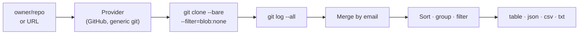

# whocommitted

[](https://github.com/Elegary/whocommitted/actions/workflows/ci.yml)

[](LICENSE)

**Find every email address that ever committed to a git repository**, on all branches and tags, in a few seconds.


- **Complete**: authors, committers and `Co-authored-by` trailers, across every branch and tag (optionally pull requests too).
- **Fast**: downloads commit metadata only, never file contents. No API calls, no rate limits.
- **Flexible**: sort, group by domain, filter bots and noreply addresses, export to JSON, CSV or text.

## Install

Requires [uv](https://docs.astral.sh/uv/) and `git`.

```bash
uv tool install git+https://github.com/Elegary/whocommitted
```

Or run it once without installing:

```bash
uvx --from git+https://github.com/Elegary/whocommitted whocommitted extract octocat/Hello-World
```

## Usage

```bash
whocommitted extract owner/repo
```

The repository can be given in many forms:

| You type | Works |
| --- | --- |
| `owner/repo` | ✅ GitHub |
| `https://github.com/owner/repo` (any page of it) | ✅ GitHub |
| `git@github.com:owner/repo.git` | ✅ GitHub |
| `https://gitlab.com/group/project.git`, any other git URL | ✅ any host |
| `./path/to/local/repo` | ✅ local |

### Sort

```bash
whocommitted extract owner/repo --sort commits          # most active first
whocommitted extract owner/repo --sort last-seen        # most recently active first
whocommitted extract owner/repo -s domain -s commits    # combine keys
whocommitted extract owner/repo --sort name --reverse   # Z → A
```

Keys: `email` (default), `name`, `domain`, `commits`, `first-seen`, `last-seen`.

### Group

```bash
whocommitted extract owner/repo --group-by domain --sort commits
whocommitted extract owner/repo --group-by kind
```

`kind` sorts addresses into `organization`, `personal` (gmail, outlook…), `noreply` and `bot`.

### Filter

```bash
whocommitted extract owner/repo --no-bots --no-noreply
whocommitted extract owner/repo --domain example.com
whocommitted extract owner/repo --include-pulls         # also scan pull requests, including forks
```

### Export

```bash
whocommitted extract owner/repo -f json | jq '.[].email'
whocommitted extract owner/repo -f csv -o emails.csv
whocommitted extract owner/repo -f txt                  # email<TAB>name
```

Run `whocommitted extract --help` for every option.

### Every repository of a user or organization

[`scripts/owner-emails.sh`](scripts/owner-emails.sh) lists the repositories through the GitHub API,
runs whocommitted on each one and merges the results by domain (needs `curl` and `jq`):

```bash
scripts/owner-emails.sh <user-or-org> --no-bots --no-noreply
# → whocommitted-<user-or-org>/by-domain.txt and by-domain.json
```

Forks are skipped by default (`INCLUDE_FORKS=1` to keep them). Set `GITHUB_TOKEN` for large accounts.

## How it works



Instead of calling an API once per commit, whocommitted clones the repository **without file contents**
into a temporary directory and reads the whole history in a single `git log --all`.
The temporary clone is deleted when it finishes.

Private repositories work with your usual git credentials (SSH key or credential helper).

## Responsible use

Commit metadata is public, but email addresses are personal data.
Use whocommitted for legitimate purposes (auditing your own projects, attributing contributions,
security research) and respect applicable privacy laws such as the GDPR. Do not use it for spam.

## Contributing

```bash
git clone https://github.com/Elegary/whocommitted && cd whocommitted
uv sync
uv run pre-commit install
uv run pytest
```

Commit messages follow [Conventional Commits](https://www.conventionalcommits.org/);
releases and the changelog are generated automatically.

Adding a new host (GitLab, Bitbucket…) means adding one small class to
[`src/whocommitted/providers/`](src/whocommitted/providers/): see [`github.py`](src/whocommitted/providers/github.py).

To update the demo GIF: `vhs docs/demo.tape`.

## License

[MIT](LICENSE)
