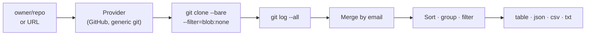

# whocommitted

[](https://github.com/Elegary/whocommitted/actions/workflows/ci.yml)

[](LICENSE)

**Find the email address and name of everyone who ever committed to a git repository**, on all branches and tags, in a few seconds.


*Emails and names in this demo are masked with `--redact`.*

- **Complete**: authors, committers and `Co-authored-by` trailers, across every branch and tag (optionally pull requests too).
- **Fast**: downloads commit metadata only, never file contents. No API calls, no rate limits.
- **Flexible**: sort, group by domain, filter bots and noreply addresses, export to JSON, CSV or text.

## Install

Requires Python 3.11+ and `git`.

With [uv](https://docs.astral.sh/uv/) (recommended):

```bash
uv tool install git+https://github.com/Elegary/whocommitted
```

With pip:

```bash
pip install git+https://github.com/Elegary/whocommitted
```

Or try it without installing anything:

```bash
uvx --from git+https://github.com/Elegary/whocommitted whocommitted extract octocat/Hello-World
```

## Usage

```bash
whocommitted extract owner/repo
```

The repository can be given in many forms:

| You type | Works |
| --- | --- |
| `owner/repo` | ✅ GitHub |
| `https://github.com/owner/repo` (any page of it) | ✅ GitHub |
| `git@github.com:owner/repo.git` | ✅ GitHub |
| `https://gitlab.com/group/project.git`, any other git URL | ✅ any host |
| `./path/to/local/repo` | ✅ local |

### Sort

```bash
whocommitted extract owner/repo --sort commits          # most active first
whocommitted extract owner/repo --sort last-seen        # most recently active first
whocommitted extract owner/repo -s domain -s commits    # combine keys
whocommitted extract owner/repo --sort name --reverse   # Z → A
whocommitted extract owner/repo --sort commits --limit 20   # top 20 only
```

Keys: `email` (default), `name`, `domain`, `commits`, `first-seen`, `last-seen`.

### Group

```bash
whocommitted extract owner/repo --group-by domain --sort commits
whocommitted extract owner/repo --group-by kind
```

`kind` sorts addresses into `organization`, `personal` (gmail, outlook…), `noreply` and `bot`.

### Filter

```bash
whocommitted extract owner/repo --no-bots --no-noreply
whocommitted extract owner/repo --domain example.com
whocommitted extract owner/repo --include-pulls         # also scan pull requests, including forks
```

### Export

```bash
whocommitted extract owner/repo -f json | jq '.[].email'
whocommitted extract owner/repo -f csv -o emails.csv
whocommitted extract owner/repo -f txt                  # email<TAB>name
```

### Share results without exposing people

```bash
whocommitted extract owner/repo --redact     # d*****e@example.com · D. L.
```

`--redact` masks the local part of every email and shortens names to initials, in every format.
Domains stay visible so grouping still works; keep in mind that a personal domain
(`me@janedoe.dev`) can still identify someone.

Run `whocommitted extract --help` for every option.

### Every repository of a user or organization

[`scripts/owner-emails.sh`](scripts/owner-emails.sh) lists the repositories through the GitHub API,
runs whocommitted on each one and merges the results by domain (needs `curl` and `jq`):

```bash
scripts/owner-emails.sh <user-or-org> --no-bots --no-noreply
# → whocommitted-<user-or-org>/by-domain.txt and by-domain.json
```

Forks are skipped by default (`INCLUDE_FORKS=1` to keep them). Set `GITHUB_TOKEN` for large accounts.

## Use cases

The demo above, step by step. Add `--redact` to mask the results, as in the GIF.

**Who built a project?** Top contributors, without bots or noreply addresses:

```bash
whocommitted extract pallets/flask --sort commits --no-bots --no-noreply --limit 10
```

**Who maintains it today?** The most recently active people first:

```bash
whocommitted extract psf/requests --sort last-seen --no-bots --no-noreply --limit 8
```

**Which company is behind it?** Contributors from one email domain, on any git host:

```bash
whocommitted extract https://gitlab.com/gitlab-org/cli --domain gitlab.com --sort commits
whocommitted extract astral-sh/uv --group-by domain --sort commits --no-bots --no-noreply
```

**Feed other tools.** Plain email list, or emails and names in JSON or CSV:

```bash
whocommitted extract pallets/click -f json --sort commits | jq -r '.[].email'
whocommitted extract pallets/click -f csv -o click.csv
```

## How it works



Instead of calling an API once per commit, whocommitted clones the repository **without file contents**
into a temporary directory and reads the whole history in a single `git log --all`.
The temporary clone is deleted when it finishes.

Private repositories work with your usual git credentials (SSH key or credential helper).

## Responsible use

Commit metadata is public, but email addresses and names are personal data.
Use whocommitted for legitimate purposes (auditing your own projects, attributing contributions,
security research) and respect applicable privacy laws such as the GDPR. Do not use it for spam.

## Protect yourself

**How do I see what I'm exposing?**
Run whocommitted on your own repositories: `whocommitted extract you/repo --include-pulls`,
or `scripts/owner-emails.sh you` for all of them at once.

**How do I stop exposing my email?**
On GitHub, go to *Settings → Emails*, enable *Keep my email addresses private* and
*Block command line pushes that expose my email*, then commit with your noreply address:

```bash
git config --global user.email "12345678+you@users.noreply.github.com"
```

GitLab has the same option: *Preferences → Profile → Commit email → Use a private commit email*.

**Can I remove my email from past commits?**
Yes, with [git-filter-repo](https://github.com/newren/git-filter-repo), followed by a force push:

```bash
echo 'Me <12345678+you@users.noreply.github.com> <me@personal.com>' > ../mailmap
git filter-repo --mailmap ../mailmap
```

This changes every commit hash. It also can't clean forks, GitHub pull request refs or archives
that already copied the history. It is worth it for personal repositories; on popular ones, consider
the address exposed. For sensitive leaks, contact GitHub Support.

**Does `.mailmap` hide my email?**
No. It only changes how names are displayed; the original address stays in every commit.

**Anything else that leaks it?**
`Co-authored-by:` trailers expose your co-authors' emails, and public GPG keys contain your email.

## Contributing

```bash
git clone https://github.com/Elegary/whocommitted && cd whocommitted
uv sync
uv run pre-commit install
uv run pytest
```

Commit messages follow [Conventional Commits](https://www.conventionalcommits.org/);
releases and the changelog are generated automatically.

Adding a new host (GitLab, Bitbucket…) means adding one small class to
[`src/whocommitted/providers/`](src/whocommitted/providers/): see [`github.py`](src/whocommitted/providers/github.py).

To update the demo GIF: `vhs docs/demo.tape`.

## License

[MIT](LICENSE)
